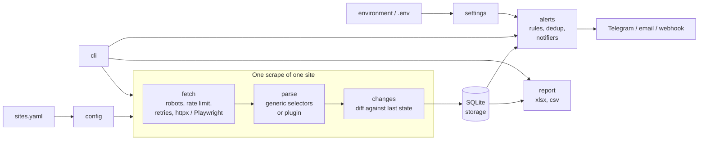

# price-monitor

A command-line tool that watches product pages for price and stock changes. Sites are described
in a YAML file, every observation is kept in SQLite, changes are detected against the history,
and alerts and Excel reports are produced from it.

## Features

- **Declarative sites.** Start URLs, pagination, item and field selectors (CSS), value transforms
  and detail-page fields live in a validated `sites.yaml`. A Python plugin hook covers sites the
  configuration cannot express.
- **History in SQLite.** Products and timestamped price/stock observations, with a versioned
  schema and a small repository layer.
- **Change detection.** New, removed, price change, back in stock and out of stock, with percent
  and absolute thresholds.
- **Alerts.** Rules in the config (price drop of at least N%, price below a target, back in
  stock, ...) delivered by Telegram, SMTP email or a JSON webhook. Identical events are not
  alerted twice.
- **Excel and CSV reports.** Products, Summary, Changes, Price history and Top movers sheets, with
  native Excel line charts for the largest movers.
- **Scheduling.** `watch` runs on an interval with jitter and stops cleanly on SIGINT/SIGTERM.
  Cron and systemd units are provided.
- **Polite by default.** robots.txt is enforced, requests are rate-limited per domain, failures
  are retried with exponential backoff and jitter, and the User-Agent is configurable.
- **Optional JavaScript rendering** through Playwright (`browser` extra), chosen per site.

## Architecture



| Package | Responsibility |
| --- | --- |
| `config`, `settings`, `transforms` | `sites.yaml` models (pydantic) and environment settings |
| `fetch` | Transports (httpx, Playwright), robots.txt, per-domain rate limiter, retry policy |
| `parse` | Generic selector-driven parser, product validation, plugin loading |
| `crawl`, `service` | Walk one site; run, store and alert for one site |
| `storage` | SQLite schema, versioning and repository |
| `changes` | Change detection and thresholds |
| `alerts` | Rule matching, deduplication, Telegram/email/webhook notifiers |
| `report` | Excel workbook and CSV |
| `scheduler`, `cli` | Watch loop and the Typer command line |

## Quickstart

Requires Python 3.12 and [uv](https://docs.astral.sh/uv/).

```bash
uv sync
uv run price-monitor sites validate
uv run price-monitor scrape --limit-pages 3
uv run price-monitor report
```

This scrapes the first three listing pages of [books.toscrape.com](https://books.toscrape.com)
(a sandbox built for scraping practice), stores 60 products in `data/price_monitor.db` and writes
`reports/products_report.xlsx` and `reports/products.csv`. Drop `--limit-pages` for the full
catalogue (1,000 products, about five minutes at the shipped rate limit).

Global options such as `--config` and `--db` go before the command:
`price-monitor --config other.yaml --db other.db scrape`.

### Docker

```bash
cp .env.example .env      # optional: add notifier credentials
docker compose up -d
```

The image runs as a non-root user and starts `price-monitor watch`. The database and reports
live in the `monitor-data` volume (`/data`); `sites.yaml` is mounted read-only from the host.

```bash
docker compose exec price-monitor price-monitor history "light in the attic"
docker compose run --rm price-monitor scrape --limit-pages 1
```

## Commands

| Command | Purpose |
| --- | --- |
| `scrape [--site NAME] [--limit-pages N] [--ignore-robots] [--simulate-changes] [--no-alerts]` | Scrape once and store the observations |
| `watch [--interval 6h] [--jitter 0.1] [--report-dir DIR]` | Scrape repeatedly until interrupted |
| `report [--out DIR] [--format xlsx\|csv\|both] [--top N] [--site NAME]` | Write the workbook and/or CSV from stored data |
| `history PRODUCT [--site NAME] [--limit N]` | Price history of one product (key, or part of the title) |
| `sites validate` | Check `sites.yaml`: schema, selectors, transforms, rules, plugins |
| `alerts test [--notifier NAME]` | Send a test message through the configured notifiers |

Exit codes: `0` success, `1` a run or lookup failed, `2` invalid configuration or usage.

### How runs are compared

- The first successful run of a site is a **baseline**: observations are stored, no changes are
  reported.
- Each later run is compared with the latest stored state of every product.
- New and removed products are only reported when the previous run used the same
  `--limit-pages` and this run had no failed pages. Otherwise they would be false positives, so
  detection is skipped for that run and a warning is logged. Price and stock changes are still
  reported.
- A product that disappears is marked inactive; if it returns it is reported as new.
- A price change is reported when it meets **every** configured threshold. With none configured,
  any change counts. The comparison is always against the previous observation, so a slow drift
  made of changes below the threshold is not reported.

## Configuration

### `sites.yaml`

```yaml
sites:
  books-toscrape:                   # site name, used in the database and reports
    start_urls: [https://books.toscrape.com/catalogue/page-1.html]
    currency: GBP
    key: upc                        # field that identifies a product (default: url)
    pagination: {type: next_link, selector: li.next a}
    item_selector: article.product_pod
    fields:                         # extracted from each item on the listing page
      title: {css: h3 a, attr: title}
      url: {css: h3 a, attr: href}
      price:
        css: p.price_color
        transforms: [{type: price, locale: en_GB, currency: GBP}]
    detail:                         # extracted from each product page
      fields:
        upc: {css: table.table-striped tr:first-child td}
        stock:
          css: p.availability
          transforms: [{type: regex, pattern: '\((\d+) available\)'}, {type: int}]
          default: 0
    request: {delay_seconds: 0.25, concurrency: 4}
    thresholds: {min_percent: 1}

alerts:
  rules:
    - {name: price-drop-10, type: price_drop, min_percent: 10}
```

The complete working file is [`sites.yaml`](sites.yaml). A second, neutral template for a typical
shop (URL-template pagination, European number format, stock text, notifier routing) is in
[`examples/sites.example.yaml`](examples/sites.example.yaml); its domain is a placeholder.

**Site**

| Key | Default | Description |
| --- | --- | --- |
| `enabled` | `true` | Disabled sites are skipped unless named with `--site` |
| `start_urls` | required | One or more listing URLs; each is paginated separately |
| `currency` | required | ISO 4217 code stored with every price |
| `key` | `url` | Field that identifies a product across runs; must be defined in `fields` or `detail.fields` |
| `renderer` | `http` | `http` (httpx) or `browser` (Playwright) |
| `browser` | | `wait_until` (`domcontentloaded`, `load`, `networkidle`, `commit`) and `wait_for_selector`; only for `renderer: browser` |
| `pagination` | none | `next_link` or `url_template` (below) |
| `item_selector` | required | CSS selector matching one element per product on a listing page |
| `fields` | required | Field name to field spec; `title` and `price` must exist in `fields` or `detail.fields` |
| `detail.fields` | none | Same, evaluated on the product page; requires a `url` field. Values override listing values |
| `request` | below | Request settings |
| `thresholds` | none | `min_percent`, `min_absolute`: smaller price moves are ignored |
| `plugin` | none | `package.module:factory`; replaces the generic parser (see below) |

Core field names are `title`, `price`, `url`, `category`, `stock` (integer), and `in_stock`
(boolean; derived from `stock` when absent). Any other field is stored as a product attribute and
appears as an extra column in the reports.

**Field spec**

| Key | Description |
| --- | --- |
| `css` | Selector evaluated inside the item (or the page, for detail fields). Omit it to read from the item element itself |
| `attr` | Attribute to read instead of the text. `class` is returned as a space-joined string |
| `transforms` | Ordered list applied to the extracted string |
| `default` | Used when nothing matches or a transform fails. Without it, a failure drops the item and counts as a failure of the run |

**Transforms**

| `type` | Options | Result |
| --- | --- | --- |
| `strip` | | Trimmed string |
| `int` | | First integer in the text (thousands separators `,` removed) |
| `price` | `locale` (default `en`), `currency` | Float parsed with the locale's separators, e.g. `de_DE`: `1.299,00 EUR` is `1299.0`. With `currency`, the text must contain that currency's symbol or code |
| `regex` | `pattern`, `group` | The given group, or group 1 if the pattern has groups, else the whole match |
| `map` | `values`, `default` | Dictionary lookup, e.g. rating words to numbers |
| `contains` | `text`, `case_sensitive` | Boolean |

Supported price locales: `en ja zh ko he th de es it nl pt tr id da el ro fr ru pl cs sv nb fi uk sk hu`.

**Pagination**

| `type` | Options |
| --- | --- |
| `next_link` | `selector` (CSS of the link to the next page), `max_pages` (default 200) |
| `url_template` | `template` containing `{page}`, `first_page` (default 1), `max_pages` (default 200). Stops at the first page without items |

**Request**

| Key | Default | Description |
| --- | --- | --- |
| `delay_seconds` | `1.0` | Minimum spacing between requests to the same domain (raised to robots.txt `Crawl-delay` if larger) |
| `concurrency` | `1` | Parallel detail-page requests, 1 to 8 (forced to 1 for the browser renderer) |
| `timeout_seconds` | `20` | Per-request timeout |
| `max_retries` | `3` | Retries after the first attempt, for network errors and HTTP 408/425/429/5xx |
| `backoff_base_seconds` | `1.0` | Backoff is `base * 2^attempt` with jitter, capped at 60 s; `Retry-After` is honoured |
| `headers` | none | Extra request headers |
| `user_agent` | from settings | Overrides `PRICE_MONITOR_USER_AGENT` for this site |
| `encoding` | detected | Force a response encoding, for servers that omit the charset |

**Alert rules** (all accept `name`, `sites`, `title_regex`, `notify`, `cooldown_hours`)

| `type` | Options | Fires when |
| --- | --- | --- |
| `price_drop` | `min_percent`, `min_absolute` | Price fell by at least every configured amount |
| `price_increase` | `min_percent`, `min_absolute` | Price rose by at least every configured amount |
| `below_target` | `target` | Price crosses to or below `target`, or a new product appears at or below it |
| `back_in_stock` | | A product with known stock status becomes available |
| `out_of_stock` | | A product becomes unavailable |
| `new_product` | | A product appears |
| `removed_product` | | A product disappears |

`notify` restricts a rule to some of `telegram`, `email`, `webhook`; by default every configured
notifier receives it.

### Environment variables

Read from the environment and from a `.env` file in the working directory. Copy
[`.env.example`](.env.example). Nothing secret belongs in `sites.yaml` or in the repository.

| Variable | Default | Description |
| --- | --- | --- |
| `PRICE_MONITOR_CONFIG_PATH` | `sites.yaml` | Site configuration |
| `PRICE_MONITOR_DB_PATH` | `data/price_monitor.db` | SQLite database |
| `PRICE_MONITOR_LOG_LEVEL` | `INFO` | `DEBUG`, `INFO`, `WARNING`, `ERROR` |
| `PRICE_MONITOR_LOG_FORMAT` | `text` | `text` (key=value) or `json` |
| `PRICE_MONITOR_USER_AGENT` | `price-monitor/<version>` | Default User-Agent; add a contact address |
| `PRICE_MONITOR_WATCH_INTERVAL` | `6h` | `watch` interval: `90s`, `30m`, `6h`, `1d` |
| `PRICE_MONITOR_WATCH_JITTER` | `0.1` | Random fraction added to or removed from each interval |
| `PRICE_MONITOR_TELEGRAM_BOT_TOKEN`, `..._CHAT_ID` | | Telegram notifier |
| `PRICE_MONITOR_SMTP_HOST`, `_PORT`, `_USERNAME`, `_PASSWORD`, `_FROM`, `_TO`, `_SECURITY` | port 587, `starttls` | SMTP notifier; `_TO` is comma-separated; security is `starttls`, `ssl` or `none` |
| `PRICE_MONITOR_WEBHOOK_URL`, `_BEARER_TOKEN` | | Webhook notifier |

## Adding a site

1. Open the listing page and a product page in the browser and note CSS selectors. Check
   `view-source:` to confirm the data is in the HTML and not built by JavaScript.
2. Copy `examples/sites.example.yaml` and edit it. Set `key` to something stable across runs (a
   SKU or UPC; the URL works if it never changes).
3. Run `price-monitor --config my-sites.yaml sites validate` to check the schema and selectors
   syntax.
4. Run `price-monitor --config my-sites.yaml --db try.db scrape --limit-pages 1` and inspect the
   result with `report`. Items that cannot be parsed are logged with the reason.
5. Pages that build the list with JavaScript need `renderer: browser`
   (`pip install price-monitor[browser]` and `playwright install chromium`).

### Plugins

For markup that selectors cannot express, point `plugin` at a factory. It receives the
`SiteConfig` and returns an object with `parse_listing(html, url, page) -> ListingPage` and
`parse_detail(html, url, item) -> dict`. Fetching, robots, rate limiting, storage and alerts still
apply. [`examples/custom_parser.py`](examples/custom_parser.py) reads schema.org JSON-LD:

```yaml
sites:
  jsonld-shop:
    start_urls: [https://shop.example.com/list]
    currency: EUR
    key: sku
    plugin: custom_parser:JsonLdParser
```

```bash
PYTHONPATH=examples price-monitor sites validate
```

## Alerts

1. Set the credentials of the channels you use in `.env` (see the table above).
2. Verify delivery: `price-monitor alerts test`.
3. Define rules under `alerts.rules` in `sites.yaml`.

**Telegram.** Create a bot with @BotFather to get the token, send the bot a message, and read the
chat id from `https://api.telegram.org/bot<token>/getUpdates`.

**Email.** Provide host, port, sender and recipients; `starttls` on port 587 is the default,
`ssl` for port 465.

**Webhook.** `POST` with `Content-Type: application/json` and, if a token is set,
`Authorization: Bearer <token>`:

```json
{
  "source": "price-monitor",
  "version": "0.1.0",
  "sent_at": "2026-10-15T12:00:00+00:00",
  "alerts": [
    {
      "rule": "price-drop-10", "site": "books-toscrape", "kind": "price_change",
      "key": "a897fe39b1053632", "title": "A Light in the Attic",
      "url": "https://books.toscrape.com/catalogue/a-light-in-the-attic_1000/index.html",
      "currency": "GBP", "old_price": 51.77, "new_price": 44.0, "percent_change": -15.0
    }
  ]
}
```

All alerts produced by one run for a notifier are sent as one message.

**Deduplication.** Every delivered alert is logged per notifier with a fingerprint of rule, site,
product, kind and old/new price. The same fingerprint is not sent again within the rule's
`cooldown_hours` (default 168). A price that drops, recovers and drops by the same amount again
after the cooldown alerts again. A notifier that fails is not marked as sent, so a later identical
event can still reach it, but a failed delivery is not retried on its own. Notifier errors never
include URLs or tokens.

## Scheduling

`price-monitor watch` loops forever: scrape every site, sleep for the interval plus or minus
jitter, repeat. SIGINT and SIGTERM stop it after the current scrape.

```bash
price-monitor watch --interval 6h --jitter 0.1 --report-dir reports
```

**cron.** [`deploy/cron/price-monitor`](deploy/cron/price-monitor) is an `/etc/cron.d` entry that
runs `price-monitor scrape` every six hours with the environment loaded from a file.

**systemd.** [`deploy/systemd/`](deploy/systemd) contains `price-monitor.service` (long-running
`watch`) and a `price-monitor-scrape.service` with a `.timer` (one-shot scrapes with a randomised
delay). Use one or the other.

```bash
sudo cp deploy/systemd/* /etc/systemd/system/
sudo systemctl enable --now price-monitor.service
# or: sudo systemctl enable --now price-monitor-scrape.timer
```

## Responsible scraping

- **robots.txt is enforced** for every origin (`urllib.robotparser`). A 4xx on `/robots.txt`
  means no rules; a 5xx or network error is treated as "disallow all" until the next run. Pass
  `--ignore-robots` to bypass it for a run; the tool logs a warning and you carry the
  responsibility.
- **Rate limiting** is per domain and shared by all threads. `delay_seconds` is the minimum gap;
  a larger robots `Crawl-delay` wins.
- **Retries** use exponential backoff with jitter and honour `Retry-After`. Client errors other
  than 408/425/429 are not retried.
- **Identify yourself.** Set `PRICE_MONITOR_USER_AGENT` to something with a contact address.
- Read the site's terms of service. Do not collect personal data, bypass access controls or
  log in with credentials you do not own. books.toscrape.com is a sandbox that invites scraping;
  most real sites do not.

This is not legal advice. Whoever runs the tool is responsible for how it is used.

## Included report

[`reports/products_report.xlsx`](reports/products_report.xlsx) was generated from a real run
against books.toscrape.com limited to three listing pages, followed by two runs with
`--simulate-changes`:

```bash
price-monitor --db demo.db scrape --limit-pages 3
price-monitor --db demo.db scrape --limit-pages 3 --simulate-changes
price-monitor --db demo.db scrape --limit-pages 3 --simulate-changes
price-monitor --db demo.db report --top 5
```

The site never changes, so the second and third runs perturb the freshly scraped data before it
is stored (some prices moved, some products marked out of stock or dropped, one synthetic product
added). The Changes, Price history and Top movers sheets therefore show **simulated** movements,
and the Products sheet includes a synthetic row titled "Simulated new product". Only the first
run is real data. Simulated runs are flagged in the database and in the Summary sheet, never send
notifications, and should only be used against a throwaway `--db`.

## Limitations

- HTTP and HTML only: no login or session handling, CAPTCHA or bot-protection solving, or proxy
  rotation. The browser renderer fetches one page at a time.
- One currency per site; prices are not converted.
- A site needs a stable `key`. Changing the key field later makes every product look new.
- Alerts that fail to send are logged but not retried automatically.
- The schema is versioned but has no migrations yet; a database from a newer release is refused.
- SQLite is written by one process at a time. Do not run several `scrape` or `watch` commands
  against the same database.
- Excel timestamps are UTC and without time zone information.

## Development

```bash
uv sync
uv run pre-commit install
uv run ruff check . && uv run ruff format --check . && uv run mypy && uv run pytest
```

Tests run without network access (HTTP is mocked with `respx`) and require 85% coverage. See
[CONTRIBUTING.md](CONTRIBUTING.md) and [CHANGELOG.md](CHANGELOG.md).

## License

[MIT](LICENSE)
